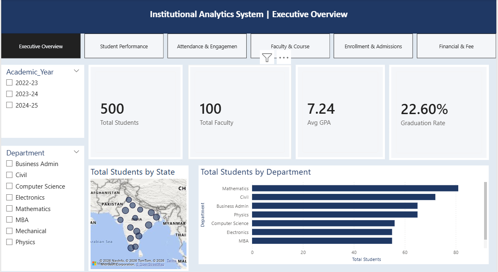
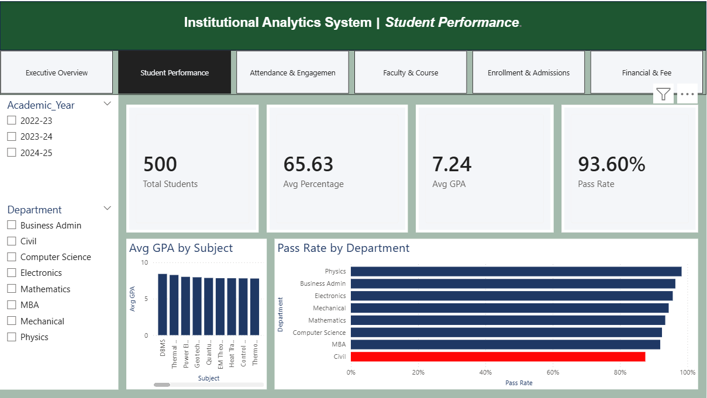
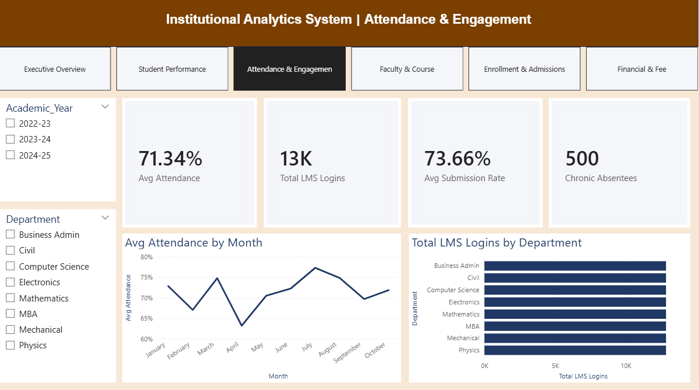
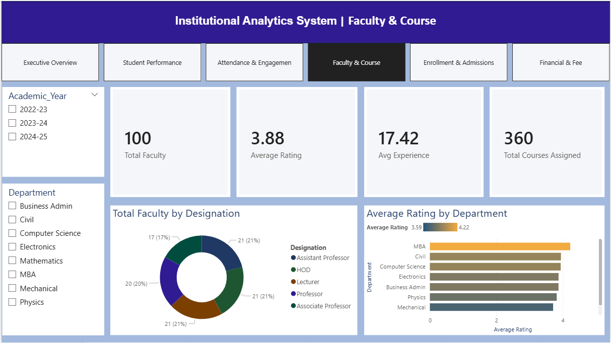
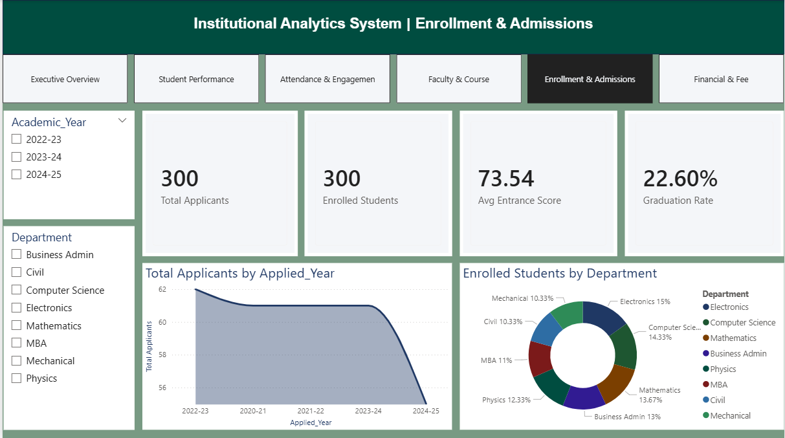
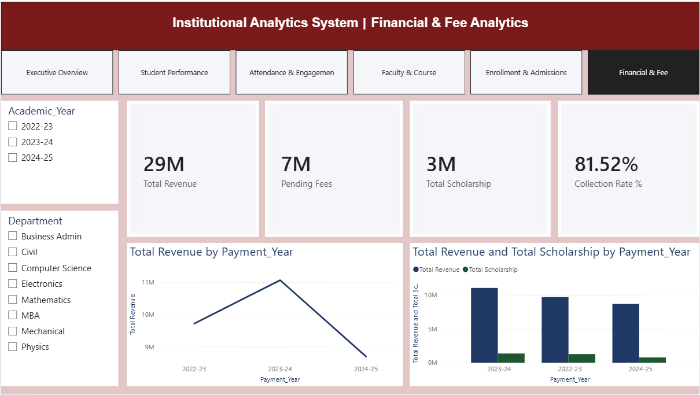

# Institutional Education Analytics System

An interactive Power BI solution that turns fragmented academic and financial
records into a single analytics dashboard for university administrators.
Built as part of the CSI Hyderabad Chapter internship on Data Analytics
using Power BI.

## Overview

- 6 interactive dashboard pages: Executive Overview, Student Performance,
  Attendance & Engagement, Faculty & Course, Enrollment & Admissions,
  Financial & Fee Analytics
- 14,528 records loaded in Import mode
- Star-schema data model, with a DAX bridge table (`DepartmentList`)
  resolving many-to-many relationships
- Cross-visual filtering, slicers and drill-downs on every page

## Dashboard Preview

### 1. Executive Overview

### 2. Student Performance

### 3. Attendance & Engagement

### 4. Faculty & Course

### 5. Enrollment & Admissions

### 6. Financial & Fee Analytics

## Key DAX Measures

| Measure | Purpose |
|---|---|
| Total Revenue | Total fees collected |
| Pending Fees | Outstanding fee amount |
| Collection Rate % | Revenue / (Revenue + Pending) |
| Avg GPA | Average academic performance |

All formulas are in [measures/dax_measures.md](measures/dax_measures.md).

## Key Insights

- 93.6% overall pass rate, with Civil flagged for academic intervention
- Average attendance of 71.34%, with a sharp dip in April
- Collection rate of 81.52% on ₹29M in revenue
- Drop in 2024-25 applicants mirrors the decline in revenue

## Tech Stack

Power BI Desktop · DAX · Power Query (M) · Star Schema Modeling

## How to Run

1. Install Power BI Desktop (free from the Microsoft Store).
2. Download `dashboard/Institutional_Analytics.pbix` from this repository.
3. Open it in Power BI Desktop and click **Refresh** if prompted.
4. If the data source path breaks, go to **Transform data → Data source
   settings** and point it to the files in the `data` folder.

## Documentation

Full project report: [Institutional_Analytics_System_Report.pdf](docs/Institutional_Analytics_System_Report.pdf)

## Future Scope

- Live biometric attendance feeds
- ML models to flag at-risk students
- Deployment to Power BI Service for mobile sharing with HODs

## Author

**Sumanth Madham**
MCA, Guru Nanak University
GitHub: [@sumanthyadav24](https://github.com/sumanthyadav24)
